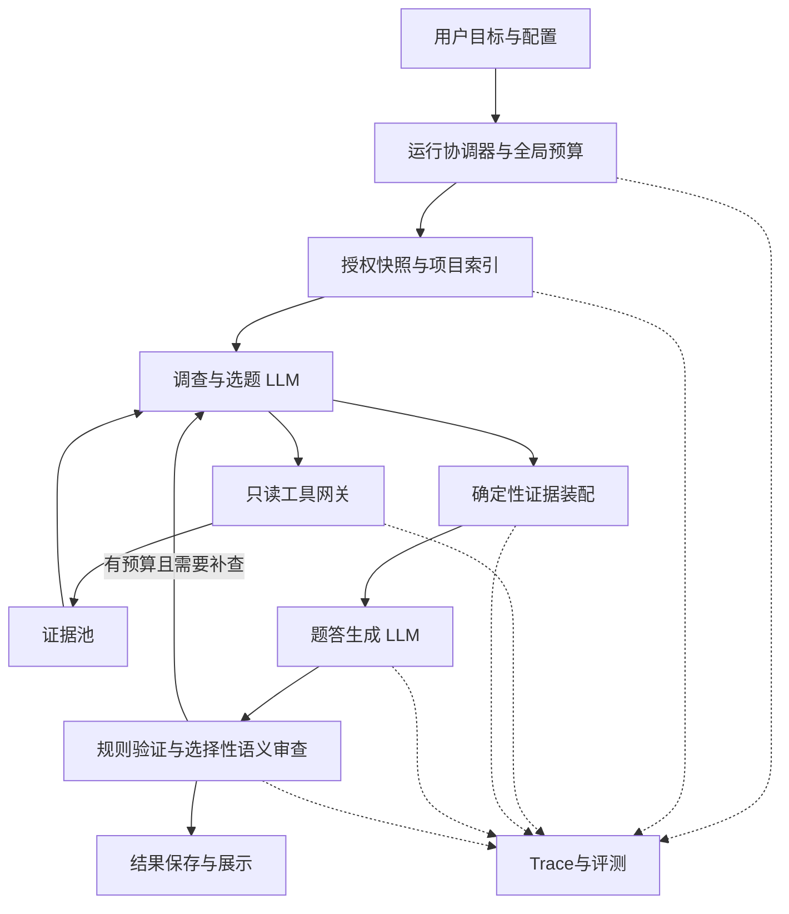

# RepoPrep Agentic Workflow 重构 PLAN

版本：v1.6，状态更新2026-11-09。状态：P0、P1 最小链路及 P2/P3 门禁已通过，P4 合成竖切已跑通、三次真实生成尝试均未完成完整矩阵；完整重构尚未完成。原代码参照 `9ef10ca`，P3真实候选为 `417b576`（运行代码及最近证据见下文）。本文件是下一阶段范围、任务、依赖和验收的主入口；[设计建议](docs/agentic-context-workflow-proposal.md)说明思路，[原阶段收尾](docs/context-selection-closeout-2026-11-06.md)保留历史结论。第11节是各模块的可判定完成门禁，其固定阈值优先于前文的概括描述。

## 1. 固定目标与完成定义

产品目标：根据用户的岗位方向、深度和题量，从真实项目证据中生成有价值、可追溯的面试问题、参考答案和追问；允许LLM动态决定调查与补查，由程序执行权限、预算、来源和生命周期约束。

| ID | 必须达到的目标 | 完成证据 |
| --- | --- | --- |
| G1 | 调查围绕面试目标，能够根据新证据调整考点与检索 | 固定任务上的调查trace、必要证据评测、题目价值复核 |
| G2 | 判断模块与工具模块独立，可替换、可单独评测 | 契约测试、模拟控制器/工具替换、组件重放 |
| G3 | 题答能追溯到实际装入模型的证据，缺口明确 | evidence lineage、实际派发清单、逐题引用验证 |
| G4 | 能定位检索、装配、生成、审查中的失败 | 标注失败集、组件替换实验、trace归因报告 |
| G5 | 质量与总成本有匹配条件的实测依据 | 静态/agentic对照、重复观测、独立保留集、完整usage与延迟 |
| G6 | 现有扫描、安全、取消、恢复、历史、导出可靠 | 相应回归及真实Electron工作流、迁移与回退验证 |

完成重构不以“模块已写完”“测试全绿”或“agent数量”判断。G1–G6均有证据，且发布门禁通过，才完成产品切换。保留集或费用授权缺失时，记录未验证状态；不把较小实验重新定义为全部目标。

**本轮固定范围**：本地代码项目、现有角色/颗粒度、现有题量契约、只读调查工具、一个有界调查控制器、确定性证据装配、题答生成、可评测审查、trace与生命周期。逻辑角色不等于独立模型调用。

**扩展范围须另立决策**：执行项目代码/测试、任意网络或外部文档检索、自动改代码、云端源码存储、跨项目长期记忆、多agent并行协商、新运行时框架/向量数据库。没有证据表明必要时，不纳入主线。

## 2. 当前事实与继承条件

- Electron主进程掌握文件、网络和存储；renderer通过受守卫IPC交互。沿用[项目规范](docs/project-standards.md)、[审查规则](docs/review.md)、[验证矩阵](docs/validation.md)。
- `context-builder.ts`目前同时承担读取、信号、选择、预算和渲染；`generator.ts`承担上下文构建、模型调用、流式解析、配额与恢复。主要改造点是拆出策略和运行编排边界。
- `readProjectContent`、脱敏、快照、`generation-tasks.ts`的runId隔离、结果契约及原子存储保留为基础能力，先适配再逐步抽取。
- `QuestionItem.sourceEvidence`与`InterviewResult.sourceEvidenceSummary`是旧版兼容字段；新系统不得直接复用其含义或把旧历史视作新验证证据。
- 当前检查点版本为2，草稿记录版本为1，仅包含批次/题目进度。调查状态、证据、预算和审查状态需要独立版本设计。
- 原四例cohort：25/28核心事实、8类实质错误、2条不精确表述、213,010 tokens；其生产源码与当前源码不同。当前离线验证不能冒充新的真实质量成绩。见[四例比较](reports/real-generation-eval/2026-11-05-doc-excerpt-cohort-v1-deepseek-v4-flash/comparison.md)和[当前离线证据](reports/context-selection-audit/2026-11-05-local-coverage/report.md)。
- 已授权的5次外部评测全部消耗；本PLAN不授权新调用。真实实验必须在候选、数据范围、端点及调用上限明确后另行确认。

## 3. 按面试官工作组织目标架构

人类工作链：明确目的 → 浏览项目 → 选择有价值的考点 → 查证机制 → 写题答 → 质疑补查 → 整理交付。调查、选题和查证允许循环；程序负责循环边界。

依赖方向：UI → IPC守卫 → 运行协调器 → 策略/工具/模型网关 → 现有读取与存储设施。证据池、预算和trace为主进程服务。工具不调用调查LLM；packer不调用LLM；LLM输出不直接访问文件或决定保存路径。

以下文件路径是目标组织建议，不要求一次性搬迁。采用渐进替换：现有服务先经adapter接入新契约，再按模块抽取，始终保留可运行的静态路径。

## 4. 模块工作包

### M01 目标与运行契约（固定规则）

- 输入：已验证的GenerateRequest、公开模型配置、用户角色/颗粒度及项目授权。
- 输出：`RunSpec`，固定run/project/snapshot身份、策略版本、题量、模型/提示版本及总预算。
- 实现：在`shared/`放跨进程最小类型；主进程内定义更完整契约并做运行时校验。保留`GRANULARITY_QUESTION_BUDGET`为唯一题量来源。
- 边界：未知用户目标不得由模型改写成确定要求；费用与权限不得由模型扩展。
- 验收：非法配置、未知策略、预算溢出拒绝；相同输入可产生稳定配置指纹；renderer无法传入私有凭据字段。
- 依赖：无。产物：契约、schema、示例及契约测试。

### M02 项目快照与可查询索引（固定规则）

- 输入：授权项目与扫描限制；输出：不可变`ProjectSnapshot`、文件ID、入口/符号/引用提示及索引不确定状态。
- 实现：适配`scanner.ts`、`project-snapshot.ts`、`scan-cache.ts`、`source-analysis.ts`；索引只消费授权、脱敏文本。
- 边界：索引是导航提示，不是完整语义证明。提供文本/按行读取入口，避免工具继承解析器的全部盲点。
- 验收：忽略策略、链接逃逸、变化检测、不可读文件、超大项目及索引缺失；快照变化后旧证据拒绝使用。
- 依赖：M01。产物：snapshot/index adapter、失效规则和fixture。

### M03 证据池与来源契约（固定规则）

- 输入：工具成功读取的脱敏片段；输出：只由程序签发的`EvidenceRecord`与ID。
- 记录：snapshotId、fileId、相对路径、原范围、脱敏内容哈希、读取/解析/省略状态、来源类别及变换版本。原范围与展示范围分开，映射无法确认时标未知。
- 实现：优先本次运行内的有界缓存；trace与源码payload分离。需要跨重启保留payload时，先完成存储策略决策和删除/容量设计。
- 边界：模型不能创建证据ID或篡改内容；同内容不同来源不能仅凭文本相同混为一条证据。
- 验收：伪造ID、旧快照、路径越界、重叠去重、脱敏后定位、容量满与读取失败。
- 依赖：M01/M02。产物：evidence store及来源验证器。

### M04 查询工具网关（固定规则）

- 输入：schema验证后的工具动作；输出：结果状态、证据ID、小型预览与预算消耗。
- 第一版工具：`get_overview`、`list_symbols`、`search_text`、`read_region`、`read_declaration_context`。名称为规划接口；读取参数使用授权ID及有界范围。
- 实现：统一经过`project-content-reader.ts`和脱敏；字面搜索、结果数/字节/时间限制、重复读取缓存、AbortSignal贯穿。
- 边界：不暴露通用fs、shell或任意HTTP；不执行项目代码。source内容中的指令没有工具授权效力。
- 验收：动作伪造、重复工具调用、取消、索引找不到但文本能找到、敏感内容和权限拒绝；工具失败返回静态原因码。
- 依赖：M02/M03/M05。产物：工具目录、schemas和离线执行器。

### M05 全局预算与模型调用网关（固定规则）

- 输入：RunSpec、阶段预算与调用请求；输出：受限调用结果、usage收据与剩余额度。
- 实现：复用`llm.ts`；统一计入调查、生成、审查、格式修复、补偿和失败。调用前预留额度，完成后按收据结算；未知usage不补零，保持保守预留，余量无法保证时停止新增调用。
- 分开记录：provider实际token、应用估算、读取字节、最终上下文字符和墙钟耗时。没有可靠计费依据时不生成货币费用。
- 给最终生成预留预算，调查不能花光全部额度；回退、重试、恢复也使用同一账本。取消已发出的请求不代表没有费用。
- 验收：超预算前阻断、缺失收据、部分流失败、重试计数、取消与重复结算。第一版调查顺序执行；并行调用以后必须证明预留的原子性。
- 依赖：M01。产物：budget ledger/model adapter；不替换凭据存储。

### M06 调查与选题控制器（LLM判断，程序运行循环）

- 输入：目标、小型项目概览、工具结果、证据ID与剩余预算；输出：`TopicCard[]`、证据需求、选择清单及未解决项。
- TopicCard包含考点价值、关注机制、期望难度、所需证据组合；不是提前编好的答案。
- 使用结构化动作协议：`request_tools`、`propose_topics`、`select_evidence`、`finish_investigation`；仅已知动作可执行。第一版可用现有JSON模型接口，不要求native tool calling或新框架。
- 允许根据证据修改/放弃考点，批量检索。工具结果是资料；简短工作摘要不能替代最终答案所需原始证据。
- 主程序限定轮数、重复无进展次数、读取量和时间；模型不能自行追加额度。动作无效的修复次数同样受限。
- 验收：有隐藏源证据清单的检索任务、模糊符号、多文件调用、误导README、无证据可得、循环查询和预算终止；评分答案不进入控制器输入。
- 依赖：M01–M05/M11。产物：静态/LLM两种调查策略及组件评测入口。

### M07 确定性证据装配（固定规则）

- 输入：选中的证据ID、必需/可选组合与最终请求预算；输出：`PackedContext`和装配清单。
- 实现：复用/抽取`context-builder.ts`的预算及渲染能力，验证证据来源、去重、保留所属声明、标记省略，计入系统指令、schema和最终序列化开销。
- 必需组合放不下时返回结构化冲突，由控制器在剩余预算内重新选择或明确不充分；不能静默只保留调用点却丢掉所要求的实现。
- 必须在最终实际派发位置校验清单；后续fit不得悄悄破坏组合约束。摘要与原始证据分开标识，模型生成文本不能冒充源码。
- 验收：固定证据离线重放、边界token/字符、完整组合、源范围、文档节选、重复片段以及selected/packed差异。
- 依赖：M03/M05。产物：packer及static adapter；保留旧策略对照。

### M08 题答构造（LLM）

- 输入：RunSpec、考点卡、PackedContext和固定题量；输出：既有结果契约可接收的题答草稿，以及逐题证据sidecar。
- 实现：先从`generator.ts`分离上下文提供策略与生成编排，复用`interview-json-stream.ts`、配额、去重、术语归一化和流式保存。
- 引用必须指向该次实际packed证据；来源合法不表示断言成立。首次不复用legacy sourceEvidence字段承载新含义。
- 验收：同一固定context的生成对照、事实错误、题目价值/难度、追问一致性、格式修复及补偿成本；题量不足不得伪装成功。
- 依赖：M01/M05/M07。产物：generator adapter、题目指纹与证据sidecar。

### M09 验证、审查与定向修订（规则＋可选LLM）

- 规则验证来源、结构、题量和引用是否实际发送；语义审查检查过度断言、矛盾、缺失条件和题目价值。
- 输出分为可证明的契约失败、语义风险/错误候选、缺证据事项；每项绑定题目指纹和证据。模型自评不是验收结论。
- 第一版审查可离线运行，不默认增加生产调用；通过独立漏检/误报评测后，才开启选择性在线审查。
- 修订仅重做受影响题目；补查也走原工具/预算。被修订结果重新通过结构、去重、引用及数量检查，保留修订前后版本和原因。
- 验收：固定已标注好/坏答案、反例任务、引文存在但解释错误、无意义修订及预算耗尽。未核验内容不得显示为已验证。
- 依赖：M03–M08/M11。产物：validator、review sidecar、有限修订协议。

### M10 运行协调、恢复与存储（固定规则）

- 统一状态：created → scanning → investigating → packing → generating → validating →（可选reviewing/revising）→ succeeded；failed/cancelled为终态。所有回环都消耗同一预算。
- 所有事件绑定runId、projectId、snapshotId和单调序号；终态后拒绝新动作/保存，旧run迟到事件不得更新新UI或释放新任务槽。
- 复用`generation-tasks.ts`、draft/store/atomic-json；新检查点保存阶段、策略/prompt/工具版本、证据引用、预算账本和已完成题目，不保存凭据或隐藏思维链。
- 并发写、结果、trace与证据不是天然跨文件事务。定义manifest提交标记及恢复顺序；失败时保留可恢复前缀，不显示半写结果为完成。
- 精确恢复要求快照和证据payload可用且版本兼容；缺失时明确不可恢复，保留旧草稿并提供重建入口。不得自动重新发出状态未知的已付费调用。
- 验收：任一阶段取消、断流/退出、重复启动、跨项目切换、迟到工具、磁盘失败、策略升级与旧草稿读取。
- 依赖：M01/M03/M05/M08/M11。产物：orchestrator、新版本检查点及迁移adapter。

### M11 Trace、重放与诊断（固定规则）

- Trace字段：schemaVersion、trace/run/project/snapshot身份、span/parent身份、event序号、组件/配置版本、状态/耗时、输入输出ID/哈希、预算、收据完整性、重试/退出原因。
- 贯通needed → retrieved → selected → packed → cited → reviewed，记录被省略ID与原因；锚定`onContextDispatch`等真正发送位置。
- 默认元数据trace不含API Key、完整源码/prompt或隐藏思维链。受授权的证据快照与trace分开，设容量、保留/删除和导出脱敏规则。
- 区分三种重放：工具/packer确定性重放；录制模型响应的流程重放；真实模型重新测量。后两者不能互相冒充，快照不可用需显式标记。
- 验收：链路完整、事件乱序、终态、脱敏、缺失usage、payload删除后行为、trace写失败。诊断写失败不能破坏任务锁或污染结果；证据链缺失的运行不得用于质量验收。
- 依赖：M01；其余模块均依赖最小trace契约。产物：trace sink、录制/重放runner及失败分类。

### M12 用户界面、IPC与导出（固定规则＋用户决策）

- 展示调查/生成/验证进度、证据不足与未核验状态；用户能取消、查看相应证据、恢复兼容任务和选择策略。
- 首先提供摘要与必要诊断入口，不把所有内部trace事件塞进阅读界面。历史结果仍可打开、解释、导出。
- 新IPC必须沿renderer/preload/main/schema/authority全链路守卫；不暴露通用工具执行器给renderer。
- 引用打开前校验项目授权与snapshot身份；原文变更时显示失效，不定位到新文件的同一行冒充旧证据。
- 验收：真实组件交互和Electron工作流，取消/恢复/迟到事件、旧历史、Markdown导出与术语协议。
- 依赖：M08–M11。产物：策略入口、进度/证据视图及兼容导出。

### M13 评测与发布判定（独立于生产决策）

- 分层数据集：安全/预算/生命周期合成fixture；独立代理标注的检索任务；固定context的题答任务；好坏答案审查集；端到端真实项目集。
- 旧四仓仅作开发回归；新增保留集在调参前冻结版本与标注，标注不可进入生产prompt。揭露给开发者并据此调参后不再称独立holdout。
- 每个样本保存input/config/prompt/strategy/source版本、原run出处、评审方式和实际usage。基线与候选使用匹配条件；变更推理强度/模型等必须单列，不能混作单因素收益。
- 先检索和packer，后固定context的生成/审查，最后端到端。先证明组件机制有效，再扩大题量，避免每次跑80题。
- 错误归因通过控制变量：独立标注的充分证据替换检索；固定证据清单替换planner；固定答案测试reviewer。Trace只给线索，不单独证明原因。
- 产物：版本化eval specs、runner、失败样本索引、质量/成本对照与go/no-go记录。评测人员的事实清单和评分逻辑不被调查器访问；标注及评审代理通过独立上下文与调查器隔离。
- 依赖：M01/M11；按阶段接入其他模块。

## 5. 跨模块契约（在P1冻结）

| 契约 | 核心字段/不变量 |
| --- | --- |
| RunSpec | 用户意图、run/project身份、策略/版本、预算、模型公开配置；私有key不在其中 |
| ProjectSnapshot | 授权身份、文件ID、内容/策略指纹、索引状态；变化后旧证据失效 |
| EvidenceRecord | 程序签发ID、snapshot/file/range、脱敏哈希、来源类别、完整/省略/未知状态 |
| ToolAction/Result | actionId、允许工具、验证参数、状态、证据ID和消耗；无任意路径能力 |
| TopicCard | 考点、价值/难度依据、证据需求与未确认事项；可修订而非锁死答案 |
| SelectionPlan | 已读取ID、优先级、必要组合、缺口；不接受虚构ID |
| PackedContext | 实际使用ID、文本由程序构造、预算、遗漏原因、manifest哈希；绑定实际派发 |
| QuestionEvidenceMap | 题目及追问指纹 → packed证据ID/断言；修改答案后旧审查失效 |
| ReviewFinding | 定位、类别、证据、状态和修订关联；规则事实与模型判断分别标记 |
| RunCheckpoint/Trace | 阶段、版本、证据引用、预算、事件序号、终态；无隐式重复计费 |

路径建议：主进程内部契约与服务放`electron/services/workflow/`、`electron/services/evidence/`等边界目录；仅真正跨IPC的数据进`shared/`。名称在P1确定。所有模型动作做运行时schema验证，不以TypeScript类型替代。

## 6. 实施顺序与阶段门禁

所有实施项的初始状态均为未开始；当前进度见第 10 节账本及 [实施记录](docs/agentic-implementation-progress.md)。每阶段结束更新状态、commit/PR、验证路径、预算消耗、失败和偏差；不能只打勾。

| 阶段 | 工作包与交付 | 进入下一阶段的门禁 | 回退方式 |
| --- | --- | --- | --- |
| P0 目标/基线冻结 | 冻结G1–G6、范围、当前静态基线、实验配对条件与成功阈值；登记ADR与数据集 | 目标、成本/延迟限额、样本/重复规则在测量前明确；没有隐藏待定标准 | 无运行时变化 |
| P1 契约与可观测静态链路 | M01/M11/M13最小实现；给静态流程接trace；用adapter建立ContextProvider边界 | 合成和固定输入下正文/题量/持久化行为等价，trace能锚定实际发送 | 关闭trace适配，走旧入口 |
| P2 快照/工具/证据 | M02–M05，测试控制器使用工具；建立证据池与预算账本 | 越界、泄密、旧快照、预算越界测试全部阻断；固定工具结果可重放 | 保留静态provider和原存储 |
| P3 装配与检索组件 | M07＋M06，先scripted planner，后受限LLM调查；只跑检索任务 | 必要证据与装入保留率达到P0门槛；停机与费用上限可靠；不因覆盖简单事实逃避复杂任务 | feature flag关闭agentic策略 |
| P4 生成端到端竖切 | M08与M10运行内部分，评测侧sidecar连接证据/题答/trace | 小规模匹配对照通过，题量/流式/取消/实际引用一致；真实质量明确标注 | static策略；旧结果继续可读 |
| P5 审查实验 | M09先离线，再选择性在线与定向修订 | 漏检/误报和净修复收益达到P0标准，总调用成本仍受限 | 禁用语义审查，保留规则验证 |
| P6 恢复与数据迁移 | M10跨重启部分，trace/证据存储、版本迁移、提交manifest | 故障注入、旧草稿/旧结果、缺证据、重复计费保护及回滚验证通过 | 新记录隔离；旧格式原件保留 |
| P7 产品集成 | M12，策略/状态/证据视图、IPC和导出 | renderer、IPC、安全、恢复及真实Electron流程通过；未核验状态表达准确 | 配置回static，兼容旧阅读路径 |
| P8 扩大验收与切换 | M13完整保留集、重复观测、总成本/延迟与打包升级验证 | G1–G6均有证据，满足发布判定；用户数据兼容；显式go/no-go | 按已验证版本回退程序及策略 |

关键路径：P0→P1→P2→P3→P4；P5在P4后；P6可在P4竖切稳定后与P5并行设计/实现；P7依赖P5策略已定及P6完成；P8依赖全部。先跑通一条真实竖切，再扩展复杂度。

并行边界：P1冻结契约后，M02/M03/M05的独立实现与M13标注准备可并行；M04等前置接口可用后再接入。共享`generator.ts`/`shared/types.ts`由整合负责人串行修改，避免多个worktree同时重写公共契约。

## 7. 评测标准与成本控制

硬门禁：测试范围内未授权读取/凭据泄漏为0；最终引用来源全部可验证；预算不得越界；旧事件不得写入当前任务；缺失证据不能标已验证；旧数据不得被不可逆覆盖。这些是发布前必须验证的约束，不是当前新增实现已经达成的声明。

质量指标分开记录：必要证据到达、selected→packed保留、实质错误、核心事实覆盖、题目相关性/深度/多样性、追问质量、审查漏检/误报。禁止用关键词命中、引用合法率或模型自评替代答案正确率。

P0必须按第11节冻结数据、评审方法和限额。发布采用固定判定：相对同条件静态对照，实质错误率至少相对下降20%，核心事实覆盖率不降低，题目价值均分不降低超过0.2分（5分制）；实际总token不超过对照的110%，总耗时p95不超过对照的150%。这些是本计划的验收目标，不是已测出的效果；达不到即不切换默认策略，不能在看过结果后改成另一种更容易通过的标准。

每个实验登记假设、唯一主变量、对照、预期指标、数据/版本、预算和停止条件。小规模筛查只决定是否扩大，不充当最终验收；若质量持平却成本增加，或关键证据回退，停止推广并保留失败结果。重复随机生成不能被包装成算法改善。

预算实现先支持配置化上限及保守结算，再选择数值。第一版只设一个调查控制器，批量工具调用、证据去重和兼容缓存；不预设每个逻辑模块都必须调用一次模型。计划、生成、审查、重试以及失败全部计费统计，unknown保留unknown。不存在无限自动反思。

## 8. 兼容、发布与回滚

- 双策略并存：static与agentic使用同一目标契约和可比较trace。默认切换放在P8，之前显式选择实验策略。
- 首先保持InterviewResult和题量协议，用新sidecar承载证据。产品显示/导出需要新字段时，另作结果版本ADR并更新全部读写链路；legacy sourceEvidence保持旧义。
- 新检查点与旧版本区分。旧草稿按旧兼容路径恢复或明确提示不可继续，原件可保留；不得把调查阶段字段塞进旧checkpoint而沿用旧version。
- 迁移采用新目录/新版本写入、校验、最后提交manifest。关闭新策略不应要求删除旧结果；新版本数据若旧程序不能读取，要给出清晰兼容处理，不能承诺盲目降级可恢复一切。
- 缓存按snapshot、忽略/脱敏/解析版本隔离；LLM计划缓存另绑定目标、模型配置和prompt/策略版本。证据被清理或源码变化后不可假装精确重放。
- 准备发布时按[版本策略](docs/VERSIONING.md)确定版本。涉及持久化、IPC或跨模块架构的实施采用分支和PR；本PLAN的文档交付不等于批准发布新运行时。

## 9. 验证命令与证据管理

所有代码阶段至少typecheck及对应测试，按[验证矩阵](docs/validation.md)扩大：

| 范围 | 当前可用验证 |
| --- | --- |
| 扫描/快照/读取 | `test:scan-cache`、`test:file-selection`、`test:security` |
| 生成/预算/结果 | `test:question-budget`、`test:ipc`、`test:recovery` |
| 模型适配/凭据 | `test:ipc`；触及凭据时加`test:native-credentials` |
| UI/IPC/完整流程 | `test:renderer`、`test:security`、`test:smoke`、`test:electron:workflow` |
| 评测/上下文工具 | `test:eval`、`test:eval:real`、`test:eval:context`、`eval:context` |

新增组件的测试入口在对应PR中加入，此处不把尚不存在的脚本写成现有命令。合成模型只验证机制；真实API/质量/费用测量另有显式授权和报告。成功证据必须绑定实际源码、配置与数据，失败记录不覆盖；不重复无关全量检查来代替针对性证据。

每阶段产物至少包括：契约版本、PR/commit、测试命令/结果、trace样本、已知失败、预算实耗/未知项、回退步骤。源码payload与凭据不进入公开trace。依据既有规则保留最近验证、未解决失败和最新有效产物，清理前校验恢复归档。

## 10. 防止目标漂移的执行纪律

每个工作包开始前填写：关联G/M/P编号、输入输出、允许修改文件、依赖、验收命令、失败处理、预算与明确不做项。PR描述回答“改变了哪个决策或工具能力，哪条证据证明它有效”。没有目标关联的重构不混入当前包。

范围、契约、默认策略、预算或成功标准改变时，新增ADR：问题证据、选项、取舍、受影响模块/阶段、成本与回退；同步本PLAN版本及变更记录。不得默默扩大工具权限、换模型/推理强度后继续沿用旧对比、修改评分事实迎合候选，或把未解决项移出完成清单。

主代理负责架构、验收和整合；实施模块交给用户指定的GPT-6-Luna，在独立worktree按已冻结契约执行。完成一个可合并工作包后再推进依赖项；主工作目录保持main。每次任务结束核对Git注册与物理目录、临时克隆、未推送内容及恢复档案，保护用户修改。

**状态账本（2026-11-08）**

| 阶段 | 状态 | 实施PR/commit | 验收证据 | 下一步 |
| --- | --- | --- | --- | --- |
| PLAN | 按用户请求实施，v1.1 验收数值保持冻结 | 本次 foundation PR | 路径/命令/一致性检查 | 保持固定门禁 |
| P0 | 已通过（agent-review-v1） | foundation PR #2 后续提交 | verify:agentic:p0；11 checks、41项组件测试、4仓48事实 | 保持数据冻结，按原阈值评测 |
| P1 | 最小静态链路通过；完整 M11 仍未完成 | foundation PR #2 后续提交 | M01 gate、实际 dispatch trace 样本、静态正文/题量/checkpoint 等价性 | P2 模块边界已冻结 |
| P2 | 已通过；static 尚未替换为新账本 | foundation PR #2 后续提交 | M02/M03/M04/M05：8/7/37/12项门禁；99组件、270 IPC、118题量、34恢复；安全构建及Electron smoke | 开始有界调查与确定性装配 |
| P3 | 已通过：M06真实检索与M07装配 | `417b576`，foundation PR #2 | 40格、39格证据完整、重复读5.78%、非法执行/限额违规0、86次usage完整；M06正式gate退出0，M07 12项通过 | 保留全部失败及1格覆盖缺口，进入P4 |
| P4 | 合成竖切238项通过；三次真实尝试均未过完整矩阵 | `5496457`未知、`843f039`输出耗尽、`b243ed2`应用校验失败 | [实施账本](docs/agentic-implementation-progress.md)；14次已知收据及原未知预留保留，真实质量未验收 | 有限失败分类、writer-v3末条修复指令、只读盲评门禁；剩余405次/6,111,612输入/2,881,812输出，不自动重发原请求 |
| P5–P8 | 未开始 | — | — | 前置门禁通过后推进，不自动开启真实调用 |

**P0待产出的具体资产**：按第11节数量与分层规则选定并固定的项目SHA、任务及隐藏标注；受控评审代理与裁定记录；schema和门禁runner。资产可以尚未生成，完成标准不得继续留作待定。第一版源码证据payload仅保存在本次运行内存；跨重启时通过相同授权快照重新读取并校验哈希，无法取得相同内容则标不可恢复。metadata trace本地保留最近20次运行且最长7天、总计最多100 MiB，任一上限先到即清理最旧完整trace；失败/用户固定记录可保留但计入容量，容量不足停止新增记录并显式报错。源码/prompt默认不落盘。

## 11. 写死的模块完成标准

本节的 `verify:agentic:*` 已注册统一的失败关闭入口；M01–M07已有实际断言，其中M06依赖完整真实检索报告，M08–M13仍按缺检查或资产返回 incomplete/blocked 和非0，不能视为完成。各模块 PR 必须同时交付对应 runner 与测试资产，不能仅打印 PASS。命令从仓库根目录执行；全部gate以冻结manifest中的requiredCheckIds为依据，并实际运行对应断言。漏掉required ID、样本数不足、跳过、未知结果或源码/配置/数据哈希不匹配，均退出非0。

每条命令写入一个新的`.validation/agentic/<runId>/<module>.json`，stdout最后一行为JSON：`{"module":"M01","status":"pass","failed":0,"missing":0,"skipped":0,"unknown":0,"report":"..."}`（module按实际替换），且退出码为0才可能通过；报告还必须含源码/配置/数据指纹、逐检查结果和原始测量引用。通过标志由断言结果计算，不接受fixture自报的status。`--mode real`不得偷偷回退合成响应；缺授权、配置或完整usage时输出blocked/incomplete并退出非0。

| 模块 | 一句可判定的完成标准 |
| --- | --- |
| M01 | 跑`npm run verify:agentic:m01`，退出0且报告`validSpecAccepted=true, invalidSpecsRejected=12/12, fingerprintStable=true, privateFieldsRejected=true`，通用failed/missing/skipped/unknown全部为0，即过。 |
| M02 | 跑`npm run verify:agentic:m02`，退出0且8类快照/扫描fixture全部通过、`unauthorizedReads=0, staleSnapshotAccepted=0, cacheInvalidationPassed=true, textFallbackPassed=true`，即过。 |
| M03 | 跑`npm run verify:agentic:m03`，退出0且伪造ID、旧快照、越界、重叠、来源不同但文本相同、脱敏定位、容量耗尽7类检查全部通过，`invalidEvidenceAccepted=0, sourcePayloadInTrace=0`，即过。 |
| M04 | 跑`npm run verify:agentic:m04`，退出0且5个工具各自的合法、非法参数、越权、取消、预算耗尽、重复调用6类检查全部通过（至少30个独立check ID），`unexpectedSideEffects=0, unsafeErrorLeaks=0`，即过。 |
| M05 | 跑`npm run verify:agentic:m05`，退出0且12种账本序列全部通过，`overspendAdmissions=0, doubleSettlements=0, unknownUsageTreatedAsZero=0, generationReserveProtected=true`，即过。 |
| M06 | 跑`npm run verify:agentic:m06 -- --mode real`，退出0且20个冻结检索任务各重复2次、`completeEvidenceTaskRate>=0.90, invalidToolExecution=0, repeatedReadRate<=0.20, limitViolations=0, usageComplete=true`，即过；合成控制器测试单独通过不足以完成本模块。 |
| M07 | 跑`npm run verify:agentic:m07`，退出0且12种装配fixture全部通过，`fabricatedSourceAccepted=0, silentRequiredBundleDrops=0, budgetViolations=0, deterministicReplay=true, dispatchManifestMatched=true`，即过。 |
| M08 | 跑`npm run verify:agentic:m08 -- --mode real`，退出0且12个冻结充分证据任务各重复2次、所有输出满足既有题量/结构契约、`unpackedEvidenceCited=0, materialErrorRate<=staticControl, topicValueMean>=staticControl-0.2, usageComplete=true`，即过。 |
| M09 | 跑`npm run verify:agentic:m09 -- --mode real`，退出0且冻结的40个有错样本与40个正确样本全部评审、`errorRecall>=0.85, falsePositiveRate<=0.10`，并在20个独立修订样本上`correctRepairs>=14, introducedMaterialErrors=0`、预算均合规，即过。 |
| M10 | 跑`npm run verify:agentic:m10`，退出0且9个运行阶段各自的取消、崩溃、迟到事件3类检查全部通过（至少27项），加上旧草稿、缺快照、磁盘失败、重复启动、跨项目5类检查，`staleWrites=0, duplicateDispatchesOnRecovery=0, oldDataOverwritten=0`，即过。 |
| M11 | 跑`npm run verify:agentic:m11`，退出0且8类trace/replay场景全部通过，`requiredSpanCoverage=1, lineageValidity=1, secretLeaks=0, fabricatedReplay=0`，并正确区分三种重放模式，即过。 |
| M12 | 跑`npm run verify:agentic:m12`，退出0且renderer/IPC/security/recovery相关检查全过、真实Electron流程记录`WORKFLOW-OK`及进程退出0、fixture已删除，静态/agentic两种策略各通过8条产品旅程，`crossProjectUpdates=0, invalidCitationNavigation=0`，即过。 |
| M13 | 跑`npm run verify:agentic:m13 -- --mode real`，退出0且完整保留集矩阵、盲评裁定、收据与失败运行均入账，`releaseGatePassed=true`并满足本节全部发布阈值，即过；不能仅凭报告生成成功判过。 |

**固定样本与指标口径**

- M01的12种非法输入：缺身份、身份格式错误、未知策略、未知角色、未知颗粒度、负预算、非有限预算、超模型窗口、非法输出预留、renderer带私有key、参数混入未知动作、配置版本不兼容。
- M02的8类fixture：普通项目、嵌套忽略、敏感路径、链接逃逸、读取中变化、不可读文件、大文件上限、解析失败后文本回退。平台不能创建某类fixture时，该gate为incomplete，不以skip冒充通过。
- M05的12种序列：正常结算、调查耗尽、生成预留、请求前失败、已发请求失败、部分收据、无收据、重试、补偿、取消、重复收据、恢复后状态未知。
- M07的12种fixture：完整装入、预算刚好、超1单位、重叠范围、不同来源同文本、必要组合不可容纳、未知ID、旧快照、Unicode、文档节选、声明上下文、最终fit再次裁剪。
- M10的9阶段：scanning、investigating、tool执行、packing、generating、validating、reviewing、revising、persisting；终态之后再注入旧事件作为每项检查的一部分。
- M11的8类场景：正常、乱序、取消、工具失败、模型断流、usage未知、trace写失败、证据快照缺失。requiredSpanCoverage以manifest必需span集合为分母，不能自行减少分母。
- M12的8条旅程：首次生成、调查中取消、生成中取消、兼容恢复、项目切换并迟到完成、读取旧结果、打开证据且快照失效、Markdown导出及术语解释；两种策略都执行，不能只验证理想新流程。
- M06的20个任务覆盖Python/JS/TS、跨文件调用、继承/回调、条件/异常、配置与实际行为区别、索引失败，每类至少2个；由P0冻结具体任务与必要证据组。一个任务只有全部必要组到达且无误绑才记完整。重复读率=无新增信息且重复证据的读取次数/总读取次数，缓存命中但仍重复塞入模型也计重复。
- M08的12个任务分成上述三个语言组各4个；证据由独立标注固定，不用当前检索器挑选有利输入。候选/静态控制各重复2次，模型、推理、题量及数据保持匹配。
- M13保留集为4个未参与调参的真实仓库（Python2个、JS1个、TS1个），固定SHA；每仓coarse/medium/fine三档、static/agentic两策略、各重复2次，共48次端到端运行。原四仓另做开发回归，不混入保留集成绩；48次不是本次调用授权。
- 质量评审：两名未看到策略标签及作者答案键的独立子代理按冻结 rubric 审阅，分歧由第三个子代理裁定；全部主答案和追问纳入事实判断。按用户新授权，代理评审可构成本轮评审门禁；必须记录代理身份、输入哈希与逐样本来源依据，不能声称人工审阅。详见 [评审协议 ADR](docs/adr/agentic-subagent-evaluation.md)。
- 实质错误率=至少含一个实质错误的答案数/审阅答案总数；重复错误类别另记，不拿类别数代替错误率。核心事实覆盖按冻结复合事实的完整覆盖数/总数。题目价值按相关性、机制深度、证据针对性、追问递进各1–5分取均值。
- M13要求错误率至少相对下降20%，核心事实覆盖不降低，题目价值均分下降不超过0.2；若静态错误率为0，候选必须也为0且核心覆盖至少提高5个百分点。实际总token≤静态对照110%，耗时p95≤对照150%（最近秩法），安全/预算门禁全部通过。完整数据集判定并同时报告逐仓结果；不得隐藏失败样本或无限重跑挑最好一次。
- 第一次调查实验每任务最多3次LLM决策、8次工具调用、累计18,000输入/6,000输出tokens、2 MiB读取、180秒；默认只读本地。端到端coarse/medium每运行最多5次实际模型请求，fine最多14次（容纳现有最多11个生成批次及调查，其他调用也占该额度）；每运行累计128,000输入/65,536输出tokens、现有读取硬上限、600秒。格式修复/补偿/审查均占这些上限，不能另开账本。调用次数、读取量和本地时限由程序硬限制；token准入使用保守预留和服务商支持的输出上限，真实收据超额判验收失败，不能声称本地取消能撤销服务端费用。没有可用计量/限额能力的配置不得通过该真实门禁。

这些数值作为PLAN v1.1固定验收方案。P0负责生成具体资产并冻结hash，不能变更数量/阈值。任何数值或评审规则调整须先修改本PLAN、记录ADR与理由，再开始新的完整对照；旧结果保留，禁止追认。真实评测、代理盲评记录或使用额度不足时，对应模块保持未完成，而不是降低标准。

**变更记录**：v1（2026-11-06）建立模块与阶段；v1.1（同日）按用户要求为M01–M13增加固定命令、报告字段、样本矩阵和通过阈值，取消开放式验收标准；未启动运行时重构。

v1.2（同日）开始准备性实施，新增可执行门禁、M01 和静态 trace 接缝，登记四个新保留集 SHA 与 rubric；P0 尚缺人工标注任务及评审资源，保持未完成。RunSpec 采用独立的 8 MiB 实验总读取上限（可收紧），未接入生产调用；依据和回退见 docs/adr/agentic-foundation.md 与 docs/agentic-implementation-progress.md。v1.1 的样本数量、质量、成本和延迟阈值全部不变。

v1.3（同日）依据用户明确授权，将任务编制、标注、双盲评审及分歧裁定改为独立子代理执行；协议 agent-review-v1、输入隔离和来源记录见 docs/adr/agentic-subagent-evaluation.md。固定样本数及质量/费用/耗时阈值不变，不将代理评审冒称人工或真实端点评测，不自动授权新的外部模型调用。

v1.4（2026-11-08）登记用户后续持续授权、P4合成竖切与首次真实请求缺usage的停止记录。离线探针复现SSE封装字节会早于usage尾部耗尽原4 MiB上限，按 docs/adr/agentic-stream-wire-budget.md 准备显式、最大32 MiB的SSE字节预算；静态默认/非流式4 MiB、所有token/调用次数/时间与验收阈值保持不变。原请求原因仍未知，不追认收据或自动重发，后续候选扣除其完整预留。

v1.5（同日）登记 `843f039` 的4格完成及第5格输出耗尽失败；12次usage完整，原始15份产物哈希保留。按 docs/adr/agentic-generation-writing-budget.md 在既有字数/追问范围内收紧双方共有写作指导，writer单独升为v2；所有题量、样本、模型/推理、token/调用/时间限额和质量阈值不变，新完整矩阵不混用旧writer结果。

v1.6（2026-11-09）登记writer-v2首格2请求收据完整、应用校验失败且具体原因未留存的记录；先按 docs/adr/agentic-generation-output-diagnostics.md 补有限静态失败分类，并强化双方共同的末条修复指令/逐主问题引用字段约束。writer独立升v3，数值门槛与模型参数不变，历史原因不追认、结果不拼接。
