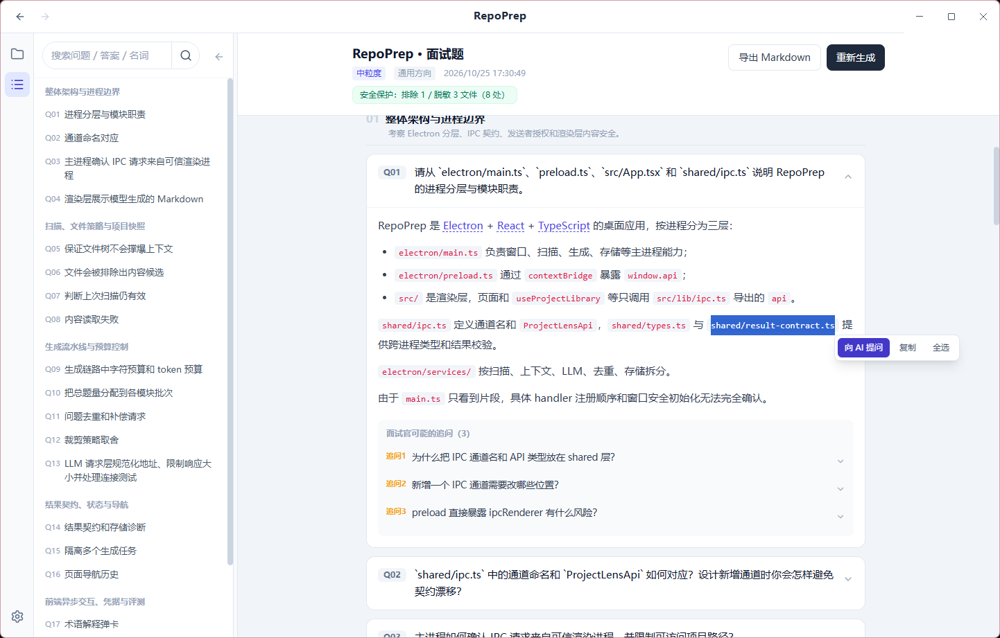
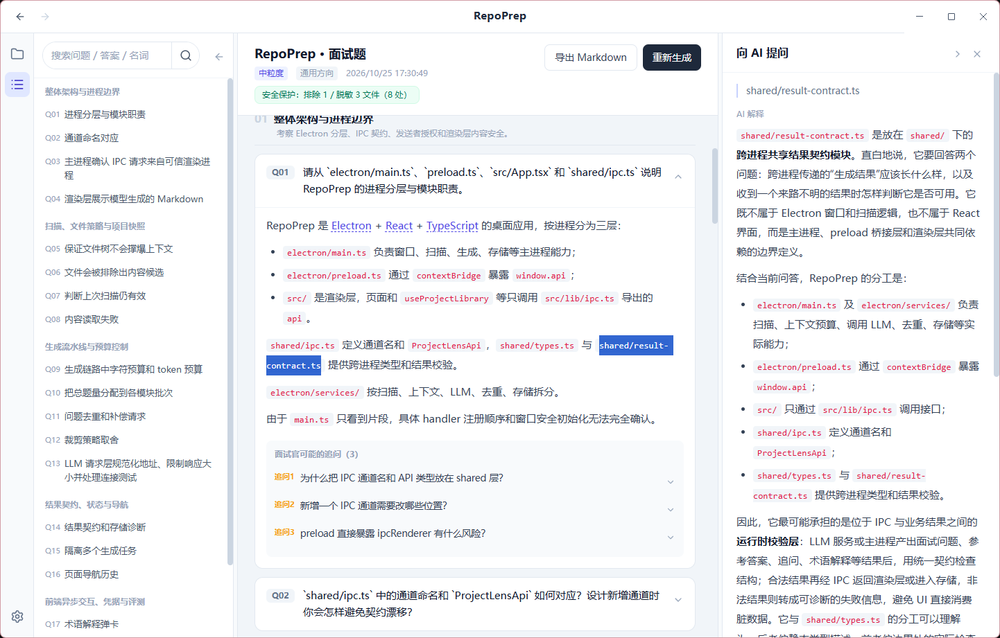

# RepoPrep

RepoPrep 是一款 Windows 桌面应用：读取本地项目代码与文档，调用你配置的大模型生成面试问题、参考答案和追问，专业名词点开即有解释，帮你按真实项目准备面试。


截图来自 RepoPrep 对自身项目生成的一份真实分析。

## 功能

- 围绕所选项目的架构、模块职责和关键实现出题，可选择通用、前端、后端或算法方向。
- 每题附参考答案与「面试官可能的追问」，逐条展开演练。
- 正文中的专业名词带下划线，点击后显示本地术语表解释；选中文本并选择「向 AI 提问」，可在右侧解释栏中获取结合本项目的解释。
- 结果页可搜索问题、答案和名词；题号稳定，搜索过滤不改变编号。
- 每个项目保留多份历史分析，可随时回看；支持导出 Markdown、后台生成。
- 流式生成与中断恢复：边生成边查看报告，完整题目逐题保存，恢复后补齐剩余题目。
- 兼容 OpenAI 与 Claude（Anthropic Messages）接口规范，按服务商配置模型。

问题深度可选粗粒度（架构级，约 8–12 题）、中粒度（模块级，约 15–25 题）和细粒度（实现级，约 25–40 题）。

## 安装使用（Windows）

从 [Releases](https://github.com/dhasho/RepoPrep/releases/latest) 下载 `RepoPrep-<版本>-x64-Setup.exe` 直接运行，不需要管理员权限。适用于 Windows 11 x64。

## 源码启动

需要 Node.js 22.15+（22.x）或 24+。

```bash
git clone https://github.com/dhasho/RepoPrep.git
cd RepoPrep
npm ci
npm run dev
```

1. 在设置中填写接口规范、服务商地址、模型名与 API Key，测试连接。
2. 侧栏「新建」选择项目文件夹，选问题颗粒度和考察方向后开始生成。
3. 查看答案与追问，点击术语查看本地解释，或选中文本后向 AI 提问；按需导出 Markdown 或回看历史分析。

生成时，所选项目的相关代码与文档会发送给你配置的模型服务。

## 界面示例

### 参考答案与追问


### 专业名词解释

点击正文中的专业名词，可查看本地术语表解释。


### 划词向 AI 提问

选中正文片段后，可选择「向 AI 提问」。



### 结合项目的 AI 解释

右侧解释栏展示结合项目内容的 AI 说明，原文仍可对照阅读。



## 更多说明

- [开发指南](docs/development.md)：环境、启动、常见问题。
- [密钥保护](docs/credential-security.md)：API Key 的存储与 IPC 边界。
- [文档索引](docs/README.md)：全部文档与报告入口。
