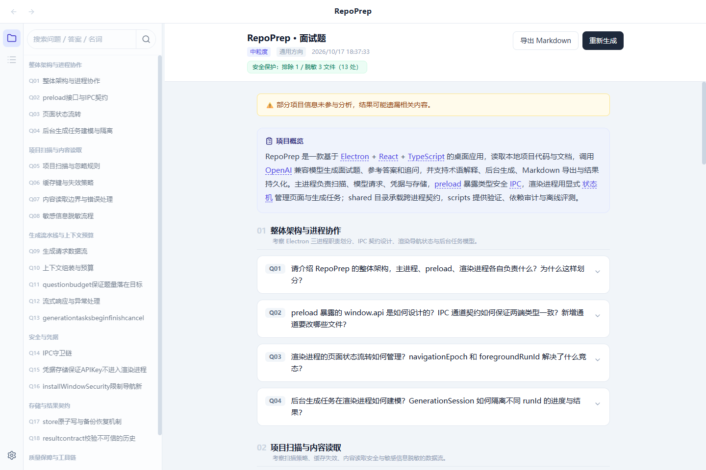
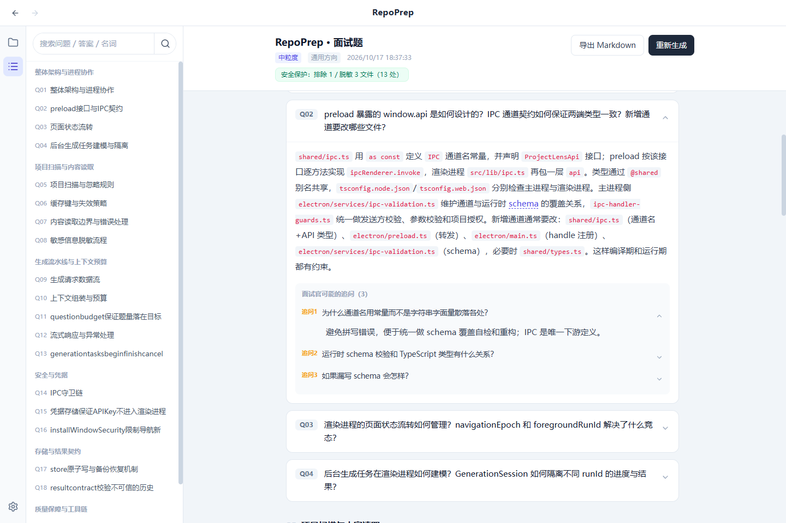
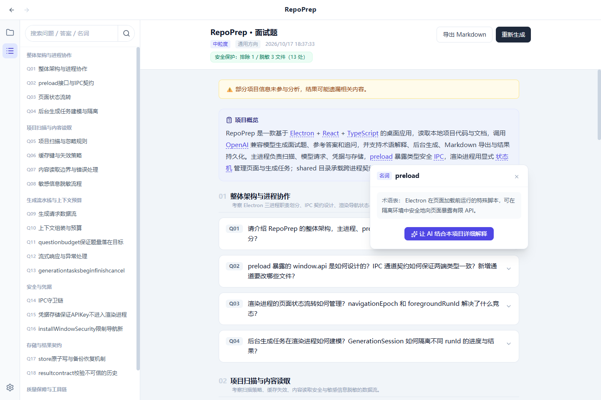

# RepoPrep

RepoPrep 是一款 Windows 桌面应用：读取本地项目代码与文档，调用你配置的大模型生成面试问题、参考答案和追问，专业名词点开即有解释，帮你按真实项目准备面试。

<div align="center"></div>

截图来自 RepoPrep 对自身仓库一次真实已保存的分析（20 题、22 个术语），仅作功能展示，不代表质量基准。

## 功能

- 聚焦项目本身：按整体架构、扫描与内容读取、生成流水线、安全、存储、质量保障等主题分组提问，粗粒度（架构级）约 8–12 题、中粒度（模块级）约 15–25 题、细粒度（实现级）约 25–40 题，可另选通用 / 前端 / 后端 / 算法方向。
- 每题附参考答案与「面试官可能的追问」，逐条展开演练。
- 正文中的专业名词带下划线，点开即显示术语表解释；需要更深入时可让 AI 结合本项目继续解释。
- 结果页可搜索问题、答案和名词；题号稳定，搜索过滤不改变编号。
- 每个项目保留多份历史分析，可随时回看；支持导出 Markdown、后台生成。
- 兼容 OpenAI 与 Claude（Anthropic Messages）接口规范，按服务商配置模型。

| 参考答案与追问 | 专业名词解释 |
| :---: | :---: |
|  |  |

## 关键技术

- **Electron + React + TypeScript**：主进程负责扫描、模型请求、凭据与存储；preload 暴露类型安全的 IPC；渲染进程关闭 Node 集成并启用上下文隔离，IPC 通道统一做发送方、运行时 schema 与项目授权校验。
- **上下文构建**：按项目入口、本地引用、配置与模块覆盖分配预算；JS/TS 基于语法结构和配置别名选取完整函数与方法，Python 使用逻辑行与缩进启发式；预算不足时明确提示省略范围。
- **题量与用量可核对**：题量以颗粒度预算为单一事实来源；结果页与 Markdown 导出显示输入估算、实际提供的文件与片段范围，以及服务商返回的 token 用量回执。
- **敏感信息保护**：扫描阶段排除凭据类文件并对密钥赋值脱敏，统计直接显示在结果页；API Key 以系统凭据存储加密保存，已保存密钥不回传渲染进程，凭据不进入日志或导出。

注意：所选项目的相关代码与文档会发送给你配置的模型服务，用于生成内容。

## 快速启动

需要 Node.js 22.15+（22.x）或 24+。

```bash
git clone https://github.com/dhasho/RepoPrep.git
cd RepoPrep
npm ci
npm run dev
```

1. 在设置中填写接口规范、服务商地址、模型名与 API Key，测试连接。
2. 侧栏「新建」选择项目文件夹，选问题颗粒度和考察方向后开始生成。
3. 查看答案与追问，点开术语解释，按需导出 Markdown 或回看历史分析。

## 深入阅读

- [开发指南](docs/development.md)：环境、启动、常见问题。
- [密钥保护](docs/credential-security.md)：API Key 的存储与 IPC 边界。
- [评测指南](docs/generation-evaluation.md)与[真实模型评测](docs/real-generation-evaluation.md)：离线校准与真实语料评测方法。
- [文档索引](docs/README.md)：全部文档与报告入口。

生成质量有固定公开语料下的小样本评测（四个项目共 80 题）：与首版基线相比，完整核心事实覆盖保持 23/28，输入 token 少约 25.1%、合计少约 18.0%。这是整版观察、由代理辅助源码复核而非人工盲审，仍有答案错误，不能视为准确率；详见[评测报告索引](reports/README.md)。
