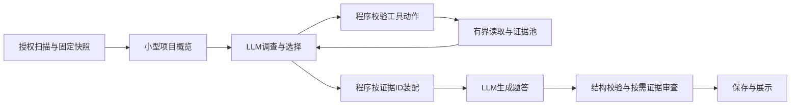

# RepoPrep Agentic context workflow 设计建议

状态：2026-11-06讨论稿，未实施。建议将语义性的调查与证据选择交给一个有界LLM控制器，保留程序对授权读取、证据完整性、预算、生命周期和结果协议的控制。逻辑模块不等于模型调用次数；规划与检索可以共用一个控制器。

吴恩达的[Agentic AI课程](https://www.deeplearning.ai/courses/agentic-ai)列出了自治程度、任务分解，以及reflection、tool use、planning、multi-agent四类模式；其第四模块专门讨论组件级评测、错误分析与延迟/成本优化。这支持按能力和证据逐步增加动态决策，而无需先给产品贴Agent标签。

他在[2024年5月8日公开信](https://www.deeplearning.ai/the-batch/issue-248/)介绍Agentic RAG时，明确讨论让模型通过检索工具决定需要获取哪些信息。相关课程[Building Agentic RAG with LlamaIndex](https://www.deeplearning.ai/alpha/short-courses/building-agentic-rag-with-llamaindex)由Jerry Liu授课，涵盖路由、工具调用及多步检索。以下方案是结合这些课程介绍与RepoPrep现状提出的工程判断，不是课程或本项目已经证明的效果。

**逻辑模块与职责**

| 模块 | 程序负责 | LLM负责 | 主要观测/评测 |
| --- | --- | --- | --- |
| 输入与项目快照 | 授权、忽略规则、脱敏、版本身份、索引和读取限制 | 通常无需调用 | 越界/泄密、快照一致性、索引缺失 |
| 调查计划与检索 | 提供有界搜索/读取工具，校验动作，累计预算 | 按面试方向决定关注主题、需要哪些证据、下一步补查什么 | 必要证据到达率、无效/重复查询、调用成本 |
| 证据选择与装配 | 验证证据ID、合并重复范围、保留来源、执行最终预算 | 提议优先级、证据组合和未解决问题 | 选中与实际装入的差异、关键证据丢失 |
| 问题与答案生成 | 题量、结构契约、去重、流式生命周期 | 组织有价值的问题、解释机制与边界 | 核心事实、实质错误、相关性、深度、重复率 |
| 证据审查与定向补查 | 引用存在性、快照/哈希/范围有效性 | 检查断言是否受证据支持，提出反例或缺失证据 | 漏检、误报、修复效果、额外成本 |
| 保存与交付 | request/project隔离、取消、迟到事件、原子保存、导出 | 无需决定文件路径或权限 | 错写/重复保存、恢复一致性 |

最值得先验证的是调查与检索。静态排序很难提前判断一道题究竟需要哪个基类方法、调用前的归一化、异常分支或测试。模型可在看到新证据后补查；但它也会漏查、选错或误读，因此生成和审查的质量仍需独立测量。

现有基础可以复用：`scanner.ts`、`project-snapshot.ts`、`project-content-reader.ts`、`sensitive.ts`作为读取边界；`context-builder.ts`中的确定性装配和预算逻辑作为packer基础；`generator.ts`、`llm.ts`、`question-budget.ts`及现有存储/IPC守卫继续承担生成和生命周期职责。逻辑边界先明确，文件搬迁与框架选型按实际需要进行。

**一条可验证的工作流**

例如，模型看到prepare调用auth/hooks后，可以继续读取prepare_hooks，发现register_hook实现未提供，再搜索相关定义和类声明。工具允许它读取真实源码，不要求开发者先穷尽所有继承或调用链规则。

工具需要两层入口：符号/引用索引用于快速定位，授权的文本搜索和有界按行读取用于处理索引盲点。若所有工具都依赖同一个不完整解析器，模型也无法修复它看不到的信息。第一版工具可限定为列出项目概览、搜索符号/字面文本、读取源区域与所属声明；工具返回已脱敏片段及证据ID。shell、项目代码执行和任意网络访问不属于第一版检索能力。

模型提交的是证据选择清单。只有本次快照中已获取、已授权的证据ID可被装配；模型生成的代码不能冒充仓库原文。需要一起出现的调用点、声明和实现可以组成证据组。组装器若无法容纳必要组合，要明确返回缺口或要求重新选择，不能静默丢掉支撑断言的部分。

**Trace应记录因果链中的可观察事实**

每次分析具有traceId、runId、projectSnapshotId、策略和prompt版本；各模块具有spanId/parentSpanId。记录状态、耗时、模型配置、工具名称及校验结果、实际provider usage（未知保留null）、估算预算、重试原因和退出原因。

最关键的链路是：

`提出需要的证据 → 实际读取 → 选中 → 最终装入 → 答案引用 → 审查结果`

证据记录包括ID、相对来源、原始范围及脱敏内容哈希；最终派发阶段绑定实际正文哈希。现有`onContextDispatch`可作为实际输入锚点。保存选中但被省略的ID及原因，区分模型没有选择与程序打包时丢失。简短行动理由可以记录，隐藏思维链不是trace的依赖。

默认trace只保存必要元数据，不记录API Key或完整源码/prompt。精确重放使用独立、受授权的证据快照；快照不可用时标为不可重放，不能读最新文件冒充旧输入。源码变化使证据ID失效；取消与迟到事件检查必须覆盖规划、工具、生成、审查的整个过程。

| Trace观察 | 优先调查的模块 | 如何进一步验证 |
| --- | --- | --- |
| 必要实现根本未读取 | 调查/检索 | 固定任务和工具结果，检查检索选择 |
| 已读取并选中，最终未装入 | 证据选择/packer | 用固定证据清单离线重放装配 |
| 证据已装入，仍产生错误断言 | 生成/推理 | 给同一生成器人工确认的充分证据作对照 |
| 错误答案未被审查发现 | 审查 | 使用固定的已标注答案测漏检/误报 |
| 预算耗尽或反复读取同一区域 | 控制器/工具协议 | 查看重复率、剩余预算、退出条件 |

Trace提供定位线索，单凭一条trace不能证明原因；固定其他输入、替换一个组件或证据集合的实验才能检验归因。引用有效也不等于断言正确，反思模型不能充当唯一验收者。

**节约无效试错的评测次序**

1. 先让当前静态流程产出同样的trace，建立对照。把输入、输出、版本和预算定义清楚；记录实际发送的内容，不能只检查规划阶段选了什么。
2. 单独评测检索：固定少量真实调查任务，用隐藏的源证据清单判断必要证据是否到达，不生成整套20题及追问。当前四仓用于开发回归，另设未参与调参的保留集；评分事实不得进入模型请求。
3. 单独重放packer：固定证据ID和预算，检查来源、完整组合、重复及省略。这个阶段无需模型。
4. 冻结检索/装配输出，评测生成器的事实错误与题目价值；给人工确认的充分证据作对照，区分证据不足与误读。
5. 对固定的正确/错误答案评测审查器。只有能降低漏检且误报可接受，才启用选择性复查或补查。
6. 最后进行匹配条件的端到端比较，计入规划、生成、审查、重试和失败的全部调用、实际token及耗时。组件改动先跑对应回归；关键接口或实际模型输入改变时再扩大验证。

不能只比较核心覆盖率：原四例覆盖增加而记录的错误也增加，说明应同时看实质错误、证据支撑、题目价值、重复率及总成本。缓存或重放的结果必须保留原来源；新上下文不能套用旧回答来宣称新质量。货币费用只有在计费依据充分时才计算。

**建议的第一版范围**

保留静态策略作为可比较基线，通过ContextProvider策略接口增加一个有界的上下文调查器。规划和检索共用一个LLM循环，批量调用只读工具，设置模型轮数、累计输入输出、读取量和时间的硬上限；模型可提前停止，程序负责最终停止。生成仍使用现有结果协议，先在评测侧以sidecar保存证据/trace，避免立即改变生产结果格式。

优先顺序是trace与模块接口、LLM检索、确定性证据装配、端到端小规模验证，再决定是否增加独立审查调用。先验证单一调查器的收益，再按trace显示的瓶颈拆更多agent。第一版可以复用现有TypeScript服务和模型客户端；无需通过引入某个框架来证明其agentic程度。

退化策略、缓存身份及预算都由程序执行。模型工具输出无效、快照变化或预算耗尽时，记录明确原因，走预先约定的静态回退或标注证据不足；回退不能绕过全局费用上限。

本文件是设计建议。本轮只完成原阶段收尾与架构分析，没有实现新控制器、启动新持续目标或调用真实模型；原5次授权已经耗尽。涉及生成链路与持久化契约的后续正式实现应按项目重大改动规则使用分支和PR，并在候选具体可审查后另行确定真实评测范围。
